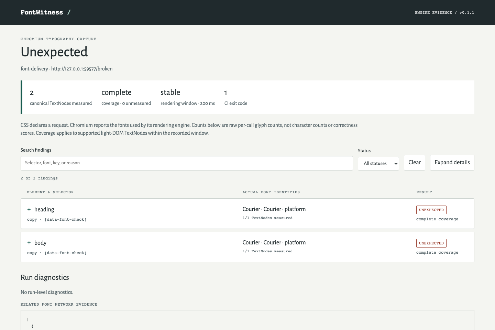

# FontWitness

See the fonts Chromium actually renders and enforce typography contracts in CI.

[](https://github.com/mikonyaa/fontwitness/actions/workflows/ci.yml) · [Release](https://github.com/mikonyaa/fontwitness/releases/tag/v0.1.1) · [Synthetic reports](https://mikonyaa.github.io/fontwitness/) · [MIT](LICENSE)

A webfont can return 404 while `getComputedStyle(element).fontFamily` still looks correct. FontWitness asks Chromium's rendering engine for the fonts used by each selected light-DOM TextNode, evaluates explicit allowed/required contracts for **every** selector match, and saves evidence you can review offline or compare later.



[Watch the real 20-second demo](docs/assets/demo.mp4). It uses the bundled synthetic site and actual CLI output: broken font delivery → measured mismatch → restored delivery → successful audit. [Broken report](site/reports/broken/report.html) and [fixed report](site/reports/fixed/report.html) are actual captures, not hand-written diagnostics.

## Quick start

Prerequisites: **Node 24 LTS**, npm, and macOS Apple Silicon or Linux x64 with Chromium's system libraries. The pinned pair is **Playwright 1.64.0 / Chromium 156.0.8078.4**, revision 1248. Browser installation is explicit; audit never downloads one. The package is distributed through GitHub Releases. It is not published to the npm registry.

In your project, using Node 24:

```sh
npm install --save-dev https://github.com/mikonyaa/fontwitness/releases/download/v0.1.1/fontwitness-0.1.1.tgz
./node_modules/.bin/fontwitness install-browser
./node_modules/.bin/fontwitness doctor
./node_modules/.bin/fontwitness demo --out ./fontwitness-demo --no-open
```

Open `fontwitness-demo/broken/report.html` directly from disk. The HTML embeds its scripts, UI font, raw data, and optional screenshot. It has no CDN or required server. `demo` exits 0 when its self-test observes **correct 0, broken 1, fixed 0, allowed language fallback 0**, and a font-changing comparison 1. The broken report remains an unexpected contract; demo success does not turn it into a pass.

On Linux, install the required OS libraries first using the distribution's normal package setup. In the source checkout, the exact bundled installer is `node node_modules/playwright/cli.js install-deps chromium`; this can require administrator privileges. Browser binaries are not inside the tarball. They use a dedicated FontWitness cache; `PLAYWRIGHT_BROWSERS_PATH` can select another explicit cache. The installer disables cross-project browser garbage collection.

`doctor --json` reports a safe reason code and action: `BROWSER_MISSING`, `VERSION_MISMATCH`, `BROWSER_LAUNCH_DENIED`, `BROWSER_LAUNCH_FAILED`, `CDP_MEASUREMENT_FAILED`, `BROWSER_CLEANUP_FAILED`, or `INTERRUPTED`. `READY` requires a real TextNode CDP font observation. An installed browser that cannot launch needs OS permissions/libraries or a sandbox-capable environment. The Chromium sandbox stays enabled; raw launch errors and environment variables are not included in doctor JSON.

The release publishes SHA256SUMS and a manifest identifying its source commit and exact CI-produced tarball. To verify before installing:

```sh
curl -fL -O https://github.com/mikonyaa/fontwitness/releases/download/v0.1.1/fontwitness-0.1.1.tgz
curl -fL -O https://github.com/mikonyaa/fontwitness/releases/download/v0.1.1/SHA256SUMS
shasum -a 256 fontwitness-0.1.1.tgz
```

Compare that digest with the tarball entry in SHA256SUMS. Avoid registry commands for an unpublished package; they could fetch unrelated software.

## Capture, contract, compare

```sh
./node_modules/.bin/fontwitness --help
./node_modules/.bin/fontwitness --version
./node_modules/.bin/fontwitness inspect http://127.0.0.1:3000 --selector '[data-font-check]' --out ./capture --json --no-open
./node_modules/.bin/fontwitness audit --config fontwitness.config.json --out ./audit --json --no-open
./node_modules/.bin/fontwitness compare ./before/capture.json ./after/capture.json --out ./comparison
./node_modules/.bin/fontwitness compare ./before/capture.json ./after/capture.json --cross-env --out ./cross-comparison
./node_modules/.bin/fontwitness init --dir ./example
```

`inspect` captures actual font usage and coverage without a typography contract verdict. Repeat `--selector` for more selections. `audit` requires a versioned JSON config. Every output directory must be new; parent directories may be created, existing output is never overwritten. Reports stay closed by default; `--no-open` makes that choice explicit. Use `fontwitness open ./audit/report.html` to open one intentionally. `--json` emits one JSON document on stdout, with progress/diagnostics on stderr. NO_COLOR and redirected output work without terminal escape codes.

`init` creates a self-contained site, fonts with their licenses, and runnable config. Run `node example/server.mjs`, then in another terminal:

```sh
./node_modules/.bin/fontwitness audit --config ./example/fontwitness.config.json --out ./example-correct
```

Change the example URL from `/correct` to `/broken` to reproduce a real 404. Restore `/fixed` to repair delivery while keeping the primary-font contract unchanged.

## Config

```json
{
  "schemaVersion": 1,
  "page": {
    "id": "home",
    "url": "http://127.0.0.1:3000/correct",
    "readySelector": "[data-app-ready]"
  },
  "browser": {
    "headless": true,
    "viewport": { "width": 1280, "height": 800 },
    "deviceScaleFactor": 1,
    "locale": "en-US"
  },
  "readiness": {
    "navigationTimeoutMs": 30000,
    "fontTimeoutMs": 10000,
    "stableWindowMs": 200,
    "maxAttempts": 3,
    "totalTimeoutMs": 90000
  },
  "limits": { "maxTextNodes": 2000, "maxMatchesPerRule": 200, "maxTextLength": 16384 },
  "artifacts": { "screenshots": "none", "includeText": false },
  "rules": [{
    "id": "copy",
    "selector": "[data-font-check]",
    "match": "all",
    "scope": "subtree",
    "minMatches": 1,
    "keyAttribute": "data-font-check",
    "allowed": [{ "familyName": "Alegreya Sans", "isCustomFont": true }],
    "required": [{ "familyName": "Alegreya Sans" }]
  }]
}
```

The names above are verified identities of the bundled example font. Build your own contracts from inspect observations. `allowed` is exhaustive, and each `required` matcher must be observed inside each separate matched element. Every explicitly supplied `familyName`, `postScriptName`, or `isCustomFont` field must match exactly, including case. There are no implicit substrings, wildcards, aliases, or guesses. The [Draft 2020-12 JSON input schema](schemas/config-v1.schema.json) accepts omitted defaulted fields, including fields inside explicitly supplied nested objects. Schema and runtime reject unknown keys. Runtime additionally enforces HTTP(S) URLs, nonempty font matchers, unique rule IDs, local preparation hooks, and audit-specific `allowed` requirements; see [config validation](docs/config.md).

For the synthetic multilingual fixture, allow `Alegreya Sans` **and** `Noto Sans CJK JP`, requiring both. An allowed Latin/CJK fallback is expected typography. Two fonts are not automatically a problem.

`scope: direct` selects immediate text children. `scope: subtree` includes supported light-DOM text descendants. Overlapping selectors reference canonical observations, so counts are not aggregated twice. Missing selectors violate minMatches. Hidden, empty, detached, unavailable, unstable, and limited selections remain unmeasured or partial. Unknown never means pass. [Measurement details](docs/measurement.md) describe the supported boundary and reason codes.

An optional local trusted preparation hook runs after DOMContentLoaded and before readiness:

```json
"preparation": { "hook": "./hook.mjs", "timeoutMs": 10000 }
```

```js
// hook.mjs — explicitly selected trusted code; not a sandbox
export async function prepare({ page, context }) {
  await page.getByRole('button', { name: 'Open sample' }).click();
}
```

Relative hook paths resolve from the config directory. URL hooks and automatic discovery are unsupported. Use only hooks you trust. Hooks may perform the site's normal auth/preparation flow with an isolated context; no cookies, authorization headers, bodies, or auth state are included in the report.

## Actual fonts and declared CSS

The bundled fixed and broken pages both request `WitnessAlias, monospace`. The fixed page returns `Alegreya Sans / AlegreyaSans-Regular / isCustomFont: true`. The broken page uses the platform monospace font and fails the primary-font contract. Its name can differ by OS; no one system-font name is assumed.

Actual evidence comes from `CSS.getPlatformFontsForNode` after public DOM/CDP TextNode resolution, not computed CSS. CSS aliases can differ from platform family names. The browser flag `isCustomFont` does not establish an HTTP URL. Per-call glyphCount is retained unchanged: it is not a Unicode character count, a correctness percentage, or proof that every glyph exists.

## Exit codes

| Code | Audit | Inspect |
| --- | --- | --- |
| 0 | All mandatory contracts fully measured and met | Complete capture; no contract verdict |
| 1 | Proven contract violation | Not a typography verdict |
| 2 | Invalid config or fatal execution error | Invalid input or fatal execution error |
| 3 | Insufficient/unsupported measurement without a proven violation | Incomplete capture |
| 130 | User interrupt | User interrupt |

Fatal execution errors take priority 2. Otherwise a proven violation takes priority 1 and retains a partial flag if coverage was incomplete. Absence of a required font is not proven by incomplete evidence.

Strict compare returns 0 for comparable runs without a significant font identity change, 1 for a font identity change, and 3 for insufficient comparability. It checks schema/policy/limits, browser and Playwright versions, OS/version/architecture, Node, headless, viewport/DPR, locale, text/structure, and stable unique page/rule/element keys. Configure unique `keyAttribute` values; a unique DOM id is the fallback key. Backend node IDs and array indices are not cross-run identity.

Saved captures are runtime validated before comparison. Malformed JSON, missing observations, duplicate IDs within their canonical scope, dangling references, contradictory counts/fingerprints/readiness/coverage, or inconsistent recorded audit verdicts return input error 2 (`INVALID_CAPTURE`). Defaults never fill gaps in saved evidence. Valid partial evidence and unsupported capture policies/browser pairs return 3 in both modes. The comparator supports `light-dom-textnodes-v2` with the pinned browser pair; identical unsupported policies do not establish comparability. Validation checks internal consistency, not the authenticity of a JSON file or its producer.

The public ESM API exports `parseCapture(value)` and `loadCapture(path)`. `compareRuns(before, after, crossEnv?)` validates both inputs at runtime and throws `CaptureInputError` with safe `code`/`issues` for malformed evidence. Complete no-change comparisons retain actual measured identities; they cannot succeed on missing observations. The CLI limits each saved input to 25 MiB.

`--cross-env` is descriptive. It allows recorded environment differences, shows actual font changes, and returns 0 for a complete comparison even with changes. Partial data, changed input/structure, absent or duplicate keys, and incompatible policies still return 3. Both modes keep `contractVerdict: null`. A font change alone is not a proven product regression. Baselines are never updated automatically.

## Verification and limits

Local validation: macOS 26.7.1, Apple Silicon arm64, Node 24.21.0, npm 11.19.0. Mandatory release CI tests Ubuntu 22.04 x64 and macOS 15 arm64; the release manifest links the precise successful run. Supported rendering engine: the pinned Chromium only.

Tests exercise real font delivery/404, permitted/forbidden language fallback, aliases, FontFace bytes, swap/deadlines, four-level nesting, sibling nodes/overlap, the last match, partial evidence, missing/hidden/empty targets, limits, browser/CDP failure, reproducibility, comparison, lazy-loading/screenshot consistency, hostile HTML/JSON, offline interaction at 1440/1024/390 px, focus/keyboard/contrast, installed package scenarios, and interrupt cleanup. Fixtures have independent expected verdicts; saved JSON is not substituted for real capture.

Full iframe/shadow DOM, canvas, SVG, generated content, and control-value measurement are outside v0.1.1. Known unsupported surfaces in a selection are reported partial; a supported light-DOM conclusion does not attest to excluded closed shadow content. The tool does not provide a per-character font map, detect all missing glyphs/tofu, prove licensing compliance, find all visual differences, or ensure identical rendering across OSes. Changes after the measured window are outside the evidence.

One URL per run. Readiness and resource limits are bounded. Trusted hooks are ordinary code and can escape time/resource expectations through synchronous work or retained handles; they are not an isolation boundary. Use a disposable environment for untrusted target pages. [Security](SECURITY.md) explains this trust model.

Screenshots and text snippets default off. Saved URLs remove credentials/query/fragment, but paths and selectors can still be private. Text fingerprints are not anonymization. Review captures before sharing. There is no telemetry, account, hosted crawler, or cloud API.

Existing [DevTools Rendered Fonts](https://developer.chrome.com/blog/devtools-answers-what-font-is-that), CSS/runtime auditing, and static glyph routing remain useful. [Technical baseline](docs/technical-baseline.md) records the narrow differences; FontWitness makes no first/only claim.

## Development

```sh
npm ci
npm run typecheck
npm run lint
npm run test:unit
npm run build
npm run schema:generate # Only when intentionally updating config.ts; review the schema diff
npm run test:schema
npm run test:malformed
node ./dist/cli.js install-browser
npm run test:integration
npm run test:package
node ./dist/cli.js demo --out ./artifacts/demo --no-open
npm pack --json
```

`test:package` creates the actual tarball after prepack, installs it outside the repository with only production dependencies, and launches its installed binary. CI preserves those exact bytes as an artifact. Browser profiles are isolated and handles close on success, timeouts, or interrupts. CI is read-only, uses upstream SHA-pinned Actions, and never exposes publish secrets or a personal self-hosted machine to fork PRs.

`build` checks that the shipped schema matches deterministic generation from `src/config.ts` using Zod input semantics. `test:schema` validates it with Ajv2020 and checks runtime parity, defaults, ranges, unknown keys, and documented runtime-only refinements. `test:malformed` exercises the real CLI's saved-capture input and comparison outcomes. Package tests repeat those cases against the installed binary and capture a consumer-owned static page with successful, broken, and restored font delivery under an unchanged contract.

Optional profiling after functional checks: `npm run profile:compare -- --baseline path/to/real/capture.json --label unique-run`. It derives explicitly synthetic typical and size-limited stress fixtures from measured identities, performs three identical load/validate/compare/report runs per fixture, and saves input hashes, phase times, peak RSS, versions, and raw results in `artifacts/performance`. This measures the Node comparison pipeline; it does not launch a browser or establish new typography evidence. The maximum fixture retains 10,000 canonical observations and 2,000 matches per full rule while staying within capture/report size ceilings.

The project is a small strict TypeScript/ESM package. Capture, pure contract evaluation, comparison, and rendering are separate modules. [Contributions](CONTRIBUTING.md) are welcome. Code: [MIT](LICENSE). Bundled fonts: [SIL OFL 1.1 with source/hash notices](THIRD_PARTY_NOTICES.md).
